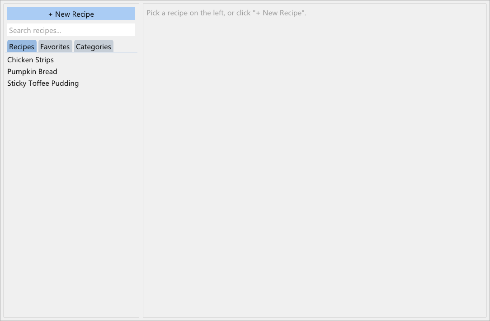
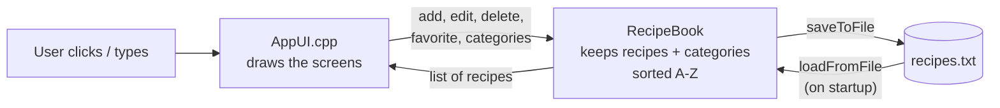

# Recipe Keeper

A Windows desktop app (C++ with a graphical interface) that keeps all my cooking and
baking recipes in one place so they're easy to find, edit, and organize. I cook and bake
a lot, so this is an app I use often.

Programming Fundamentals II (COSC 2425) major project.



**Demo video:** _(link coming soon)_

## Features

1. **Add recipes** with a name, ingredients, and step-by-step instructions
2. **View** all recipes in alphabetical order, and click one to see it
3. **Edit** any part of a recipe without starting over
4. **Delete** recipes, with an "are you sure?" popup
5. **Categories** (like Breakfast or Desserts). A recipe can be in more than one.
   Categories are listed A-Z; click one to see its recipes. Categories can be created
   and deleted (deleting a category does not delete its recipes).
6. **Favorites**: mark recipes as favorites and see just those in the Favorites tab
7. **Search** by part of a recipe's name, ignoring capital letters ("chick" finds "Chicken Strips")
8. **Save and load**: everything is saved to a file automatically, so it's all still
   there the next time the program runs

## Built with

- **C++17**
- **[Dear ImGui](https://github.com/ocornut/imgui)** for the graphical interface
  (buttons, text boxes, tabs, popups), drawn with DirectX 11
- **CMake** to build (it downloads Dear ImGui automatically)
- **Visual Studio 2026** as the editor
- **Claude (Claude Code)** as an AI coding assistant (see [AI use](#ai-use))

## How it works



| File | What it does |
|---|---|
| `src/main.cpp` | Opens the window, sets up DirectX and Dear ImGui, loads the save file, and runs the main loop (~60 times a second) |
| `src/AppUI.cpp` | Everything on screen: the recipe list, tabs, search box, recipe details, add/edit form, popups, and the Manage Categories screen |
| `src/RecipeBook.cpp` | The recipe logic, with no GUI code: add, edit, delete, favorites, categories, sorting, and saving/loading |
| `src/Recipe.h` | The `Recipe` struct: name, ingredients, steps, categories, favorite |
| `src/TextUtils.cpp` | Text helpers: lowercase, trim spaces, split lines, case-insensitive search |
| `tests/test_main.cpp` | Automated tests for the recipe logic |

Recipes are saved as plain text, so you can open the file in Notepad:

```
CATEGORY Desserts

RECIPE
NAME Sticky Toffee Pudding
IN_CATEGORY Desserts
INGREDIENT 1 cup pitted dates, roughly chopped
STEP Preheat your oven to 350°F.
FAVORITE
END
```

## How to build and run

Requirements: Windows 10/11 and **Visual Studio 2022 or newer** with the
**"Desktop development with C++"** workload.

1. Clone this repository:
   ```
   git clone https://github.com/mktowerz-dev/recipe-keeper.git
   ```
2. In Visual Studio choose **File > Open > Folder...** and pick the `recipe-keeper` folder.
   Visual Studio detects `CMakeLists.txt` and sets everything up (the first time
   it downloads Dear ImGui, which takes a minute).
3. In the green ▶ dropdown at the top, select **RecipeKeeper.exe**, then press **F5**.

Keep the project in a short folder path such as `C:\dev\recipe-keeper`. Very long
paths can make the build fail because of Windows' path-length limit.

Command line alternative (from a "Developer PowerShell for VS"):

```
cmake -S . -B build
cmake --build build --config Debug
build\Debug\RecipeKeeper.exe
```

Your recipes are saved automatically to `%APPDATA%\RecipeKeeper\recipes.txt`
(paste that into File Explorer's address bar to find it).

## Running the tests

In Visual Studio pick **RecipeTests.exe** from the ▶ dropdown and press **Ctrl+F5**,
or run `build\Debug\RecipeTests.exe`. Each check prints PASS or FAIL. The tests cover
adding, sorting, editing, deleting, categories, favorites, search, and save/load.

## AI use

I used Claude (Claude Code) throughout this project to set up my tools and GitHub,
generate and explain code, and debug problems. I wrote the Favorites feature myself
with hints from the AI. See [AI_LOG.md](AI_LOG.md) for the prompts I used, what the AI
produced, and what I changed.
